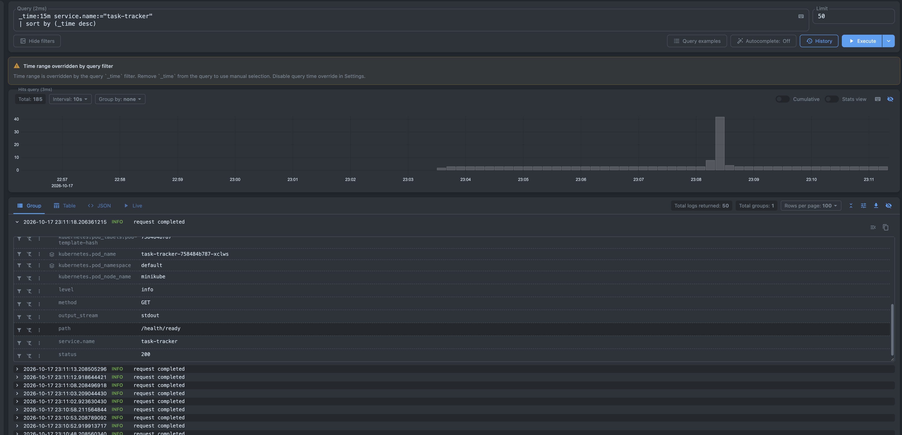
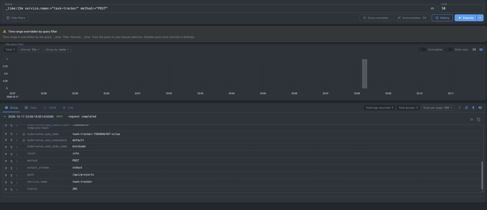
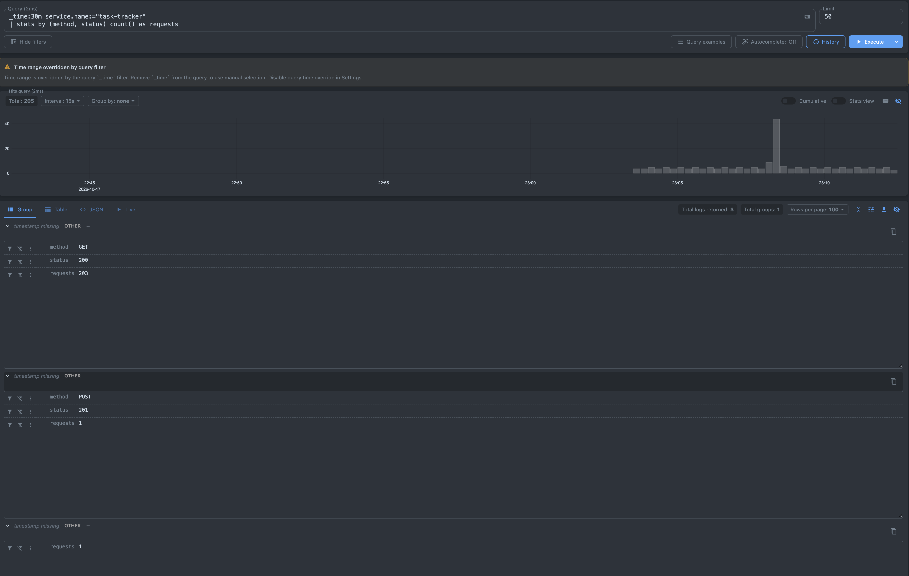
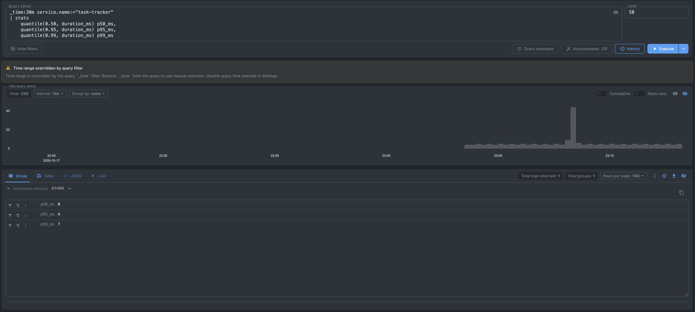
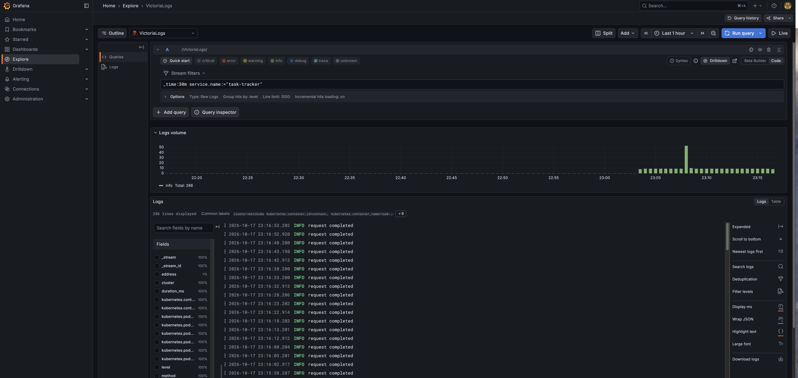

# Отчёт по приложению Task Tracker

## 1. Доменная область

Task Tracker — клиент-серверное веб-приложение для организации небольших
проектов и входящих в них задач. Пользователь может создавать, просматривать,
изменять и удалять проекты и задачи, а также менять состояние задач. Общая
доска показывает задачи из всех проектов и принадлежность каждой задачи;
выбор проекта фильтрует доску.

## 2. Стек реализации

- язык бэкенда: Go;
- HTTP-сервер и маршрутизация: стандартный пакет `net/http`;
- формат API: HTTP/1.1 REST, JSON;
- работа с базой данных: `pgx` и пул соединений `pgxpool`;
- СУБД: PostgreSQL;
- миграции: `golang-migrate`, SQL-файлы встроены в бинарный файл через `embed.FS`;
- фронтенд: HTML, CSS и JavaScript без дополнительных фреймворков;
- контейнеризация и локальное окружение: Docker и Docker Compose;
- команды разработки и запуска: Makefile.

## 3. Основные сущности

### Project

Проект объединяет связанные задачи. Содержит идентификатор, название,
описание, время создания и время последнего изменения.

### Task

Задача принадлежит одному проекту. Содержит идентификатор, идентификатор
проекта, название, описание, статус (`todo`, `in_progress` или `done`), время
создания и время последнего изменения.

Для обеих сущностей реализованы операции создания, чтения, изменения и
удаления. При удалении проекта его задачи удаляются базой данных каскадно.

## 4. Соответствие методологии «12 факторов»

### I. Кодовая база

Исходный код фронтенда, бэкенда, миграций и инфраструктурных файлов находится
в одном Git-репозитории. Из одной кодовой базы может быть создано несколько
развёртываний с разной конфигурацией.

### II. Зависимости

Зависимости явно объявлены в `go.mod`, их контрольные суммы фиксируются в
`go.sum`. Многоэтапная сборка Docker создаёт изолированное и воспроизводимое
окружение. Приложение не зависит от глобально установленных Go-пакетов.

### III. Конфигурация

Строка подключения к PostgreSQL передаётся через `DATABASE_URL`, HTTP-порт —
через `PORT`, размер пула — через `DB_MAX_CONNS`, время корректного завершения
— через `SHUTDOWN_TIMEOUT`, а применение миграций при старте управляется
`MIGRATE_ON_START`. Пример находится в `.env.example`, а `.env` исключён из
Git.

### IV. Сторонние службы

PostgreSQL рассматривается как подключаемый ресурс. Для замены локальной базы
на облачную достаточно изменить `DATABASE_URL`, не меняя код приложения.

### V. Сборка, релиз, выполнение

На стадии сборки создаются неизменяемые бинарные файлы и Docker-образ. На
стадии релиза к образу добавляется конфигурация окружения. При выполнении
запускается уже собранный бинарный файл.

### VI. Процессы

HTTP-процесс не хранит пользовательское состояние в памяти или локальных
файлах. Все постоянные данные находятся в PostgreSQL. Экземпляр сервера можно
остановить или заменить без потери данных.

### VII. Привязка портов

Приложение содержит собственный HTTP-сервер и экспортирует сервис через порт,
заданный переменной `PORT`. Внешний сервер приложений не требуется.

### VIII. Параллелизм

Приложение можно горизонтально масштабировать запуском нескольких одинаковых
web-процессов за балансировщиком. Экземпляры не зависят друг от друга и
используют общий PostgreSQL. Worker-процессы для этой предметной области не
требуются.

### IX. Утилизируемость

Приложение быстро запускается. Сигналы `SIGINT` и `SIGTERM` обрабатываются с
помощью graceful shutdown: сервер ожидает завершения текущих запросов в
пределах `SHUTDOWN_TIMEOUT`, после чего закрывает пул соединений.

### X. Паритет разработки и эксплуатации

Docker Compose запускает тот же Docker-образ приложения и ту же СУБД
PostgreSQL, которые могут использоваться в других окружениях. Отличия
окружений задаются конфигурацией.

### XI. Журналирование

Сервер выводит структурированные JSON-логи в стандартный поток `stdout` и не
управляет файлами логов. Платформа может собирать и перенаправлять поток во
внешнюю систему.

### XII. Задачи администрирования

Миграции выполняются отдельным одноразовым процессом `/app/migrate`, собранным
из той же кодовой базы и использующим ту же конфигурацию `DATABASE_URL`. В
Docker Compose контейнер миграций завершается до запуска HTTP-приложения. Для
локальной разработки предусмотрен опциональный режим `MIGRATE_ON_START=true`,
но по умолчанию он выключен, чтобы несколько реплик web-процесса не выполняли
административную задачу одновременно.

## 5. Локальный запуск через Docker Compose

```bash
cp .env.example .env
make compose-up
```

После запуска приложение доступно по адресу `http://localhost:8080`.

Для остановки: `make compose-down`.

## 6. Развёртывание в Kubernetes

Для запуска приложения использован локальный однодовый кластер Kubernetes —
Minikube с драйвером Docker. В Kubernetes развёртываются HTTP-приложение Task
Tracker, PostgreSQL и отдельная одноразовая задача для применения миграций.

Frontend не требует отдельного контейнера и Deployment: HTML, CSS и JavaScript
встроены в бинарный файл Go-приложения через `embed.FS` и обслуживаются тем же
HTTP-сервером, что и REST API.

Kubernetes-манифесты находятся в каталоге `k8s`:

- `00-config.yaml` — Secret и ConfigMap;
- `01-postgres.yaml` — PersistentVolumeClaim, Deployment и Service PostgreSQL;
- `02-migrate-job.yaml` — Job для применения миграций;
- `03-app.yaml` — Deployment и Service приложения.

### 6.1. Использованные абстракции Kubernetes

#### Secret

Secret `task-tracker-secrets` содержит название базы, пользователя, пароль и
строку подключения `DATABASE_URL`. Строка подключения передаётся приложению и
Job миграций через переменную окружения.

#### ConfigMap

ConfigMap `task-tracker-config` хранит обычную конфигурацию приложения: HTTP-порт,
размер пула соединений, таймаут корректного завершения и признак выполнения
миграций при старте. Значение `MIGRATE_ON_START=false`, потому что миграции
запускаются отдельным Job.

#### PersistentVolumeClaim

PersistentVolumeClaim `postgres-data` запрашивает 1 ГБ постоянного хранилища.
Том подключается к контейнеру PostgreSQL. Благодаря этому данные проектов и
задач не теряются при пересоздании pod базы данных.

#### Deployment PostgreSQL

Deployment `postgres` поддерживает одну реплику PostgreSQL из образа
`postgres:18-alpine`. Стратегия `Recreate` предотвращает одновременный запуск
двух экземпляров базы с одним томом. Readiness probe выполняет `pg_isready` и
показывает, когда база готова принимать подключения.

#### Service PostgreSQL

Service `postgres` имеет тип `ClusterIP` и доступен только внутри кластера на
порту 5432. Kubernetes DNS предоставляет ему стабильное имя `postgres`, поэтому
приложение использует адрес `postgres:5432`, не зная IP-адрес pod базы данных.

#### Job миграций

Job `task-tracker-migrate` запускает из образа приложения команду
`/app/migrate up`. Он применяет встроенные SQL-миграции один раз и после
успешного выполнения переходит в состояние `Complete`. Миграции вынесены из
HTTP-процессов, поэтому масштабирование приложения не приводит к их
одновременному запуску несколькими репликами.

#### Deployment приложения

Deployment `task-tracker` запускает образ `task-tracker:1.1`. Контейнер получает
обычные настройки из ConfigMap, а `DATABASE_URL` — из Secret. Deployment
позволяет управлять количеством одинаковых stateless-реплик приложения.

Для проверки состояния используются два endpoint:

- liveness probe обращается к `/health/live` и проверяет работу HTTP-процесса;
- readiness probe обращается к `/health/ready` и дополнительно проверяет
  соединение с PostgreSQL.

Pod, который не прошёл readiness probe, не получает пользовательский трафик.
При продолжительном сбое liveness probe Kubernetes перезапускает контейнер.

#### Service приложения

Service `task-tracker` имеет тип `NodePort`. Он выбирает pod с меткой
`app: task-tracker`, предоставляет единый адрес приложения и распределяет
запросы между его репликами. Для демонстрации UI использовался локальный
port-forward с порта 8080 компьютера на порт 80 Service.

## 7. Взаимодействие компонентов

Запрос проходит по следующей цепочке:

```text
Браузер
  |
  v
Service task-tracker (NodePort, порт 80)
  |
  v
один из pod Deployment task-tracker (порт 8080)
  |
  v
Service postgres (ClusterIP, имя postgres, порт 5432)
  |
  v
pod Deployment postgres
  |
  v
PersistentVolumeClaim postgres-data
```

Браузер получает встроенный frontend и отправляет REST-запросы тому же
Go-сервису. Service `task-tracker` выбирает доступную реплику по метке и
направляет ей запрос. Приложение выполняет операции с данными через PostgreSQL,
обращаясь к Service `postgres`. Все реплики Task Tracker используют одну базу
данных, поэтому пользовательское состояние не зависит от конкретного pod.

## 8. Сборка образа и подготовка Minikube

Кластер создаётся с Docker-драйвером:

```bash
minikube start --driver=docker
```

Образ приложения собирается существующим многоэтапным Dockerfile:

```bash
docker build -t task-tracker:1.1 .
```

Локальные образы передаются в Minikube без публикации во внешнем registry:

```bash
minikube image load task-tracker:1.1
minikube image load postgres:18-alpine
```

Наличие образов проверяется командой:

```bash
minikube image ls | grep -E 'postgres|task-tracker'
```

## 9. Порядок развёртывания

Сначала создаются Secret и ConfigMap:

```bash
kubectl apply -f k8s/00-config.yaml
```

Затем запускаются PostgreSQL, внутренний Service и постоянный том:

```bash
kubectl apply -f k8s/01-postgres.yaml
kubectl get pods
kubectl get services
kubectl get pvc
```

После перехода PostgreSQL в состояние `1/1 Running` применяются миграции:

```bash
kubectl apply -f k8s/02-migrate-job.yaml
kubectl get jobs
kubectl logs job/task-tracker-migrate
```

После завершения Job запускается приложение:

```bash
kubectl apply -f k8s/03-app.yaml
kubectl get all
```

Для доступа к интерфейсу использовалась команда:

```bash
kubectl port-forward service/task-tracker 8080:80
```

После этого UI доступен по адресу `http://localhost:8080`.

## 10. Масштабирование

Deployment приложения масштабируется с одной до трёх реплик:

```bash
kubectl scale deployment/task-tracker --replicas=3
kubectl get pods -l app=task-tracker -o wide
```

После масштабирования Kubernetes поддерживает три pod Task Tracker, а Service
распределяет между ними HTTP-запросы. Приложение продолжает работать с общей
базой PostgreSQL: созданные проекты и задачи доступны независимо от того, какая
реплика обработала запрос.

PostgreSQL остаётся в одной реплике, поскольку простое горизонтальное
масштабирование Deployment базы данных не обеспечивает репликацию и
согласованность данных.

## 11. Централизованный сбор логов

### 11.1. Формат логов приложения

Для журналирования используется стандартный пакет Go `log/slog` с
`JSONHandler`. Логи записываются в `stdout` контейнера и содержат поля из
рекомендованной схемы:

- `timestamp` — время события;
- `level` — уровень логирования;
- `message` — текст события;
- `service.name` — имя сервиса `task-tracker`;
- `method`, `path`, `status` и `duration_ms` — данные обработанного HTTP-запроса.

Пример записи:

```json
{
  "timestamp": "2026-10-17T20:11:18.206Z",
  "level": "info",
  "message": "request completed",
  "service.name": "task-tracker",
  "method": "GET",
  "path": "/health/ready",
  "status": 200,
  "duration_ms": 0
}
```

### 11.2. Развёртывание VictoriaLogs

VictoriaLogs развёрнута в Minikube официальным Helm-chart
`victoria-logs-single` в namespace `logging`. Используется single-node режим,
срок хранения логов составляет 7 дней, а для данных запрошен PVC размером
2 ГБ. Настройки находятся в файле
`observability/victoria-logs-values.yaml`.

Установка выполнялась командой:

```bash
helm upgrade --install vls vm/victoria-logs-single \
  --namespace logging \
  --create-namespace \
  --values observability/victoria-logs-values.yaml \
  --wait
```

Для доступа к встроенному интерфейсу vmui использовался port-forward:

```bash
kubectl port-forward \
  --namespace logging \
  service/vls-victoria-logs-single-server \
  9428:9428
```

После этого vmui доступен по адресу
`http://localhost:9428/select/vmui/`.

### 11.3. Доставка логов

Для доставки выбран официальный Helm-chart `victoria-logs-collector`, который
разворачивает `vlagent` как DaemonSet. Агент читает CRI-файлы логов контейнеров
на узле Kubernetes, автоматически разбирает JSON, добавляет Kubernetes-метаданные
и отправляет записи в VictoriaLogs по внутрикластерному адресу
`vls-victoria-logs-single-server.logging.svc.cluster.local:9428`.

Конфигурация находится в `observability/collector-values.yaml`. Дополнительно
ко всем записям добавляется поле `cluster=minikube`.

Этот способ выбран по следующим причинам:

- это официальный сборщик VictoriaLogs;
- один DaemonSet собирает логи всех pod на узле;
- не требуется добавлять sidecar в Deployment приложения;
- не требуется прямое сетевое взаимодействие приложения с хранилищем логов;
- JSON-поля приложения сохраняются и доступны для LogsQL-фильтрации и
  агрегации.

## 12. LogsQL-запросы в vmui

### 12.1. Сырые записи за последние 15 минут

```logsql
_time:15m service.name:="task-tracker"
| sort by (_time desc)
```

Запрос выбирает записи только сервиса `task-tracker` за последние 15 минут и
сортирует их от новых к старым. На скриншоте видны структурированные поля
`level`, `method`, `path`, `service.name`, `status` и Kubernetes-метаданные.



### 12.2. Фильтр по HTTP-методу

```logsql
_time:15m service.name:="task-tracker" method:="POST"
```

Запрос оставляет только HTTP-запросы с методом `POST`. В показанном результате
это создание проекта через `/api/projects`, завершившееся статусом `201`.



### 12.3. Статистика с группировкой

```logsql
_time:30m service.name:="task-tracker"
| stats by (method, status) count() as requests
```

Запрос группирует события по HTTP-методу и статусу ответа и считает количество
запросов в каждой группе. На скриншоте основная группа содержит сочетание
`GET` и `200`, отдельно показано сочетание `POST` и `201`. Группа без `method` и `status`
соответствует служебным событиям приложения, не связанным с HTTP-запросом.



### 12.4. Квантили длительности запросов

```logsql
_time:30m service.name:="task-tracker"
| stats
    quantile(0.50, duration_ms) p50_ms,
    quantile(0.95, duration_ms) p95_ms,
    quantile(0.99, duration_ms) p99_ms
```

Запрос агрегирует числовое поле `duration_ms` и показывает характерную и
худшие задержки HTTP-запросов. Для собранной выборки получены значения
`p50 = 0 мс`, `p95 = 4 мс` и `p99 = 7 мс`.



## 13. Бонус: интеграция с Grafana

В namespace `logging` дополнительно установлена Grafana с официальным плагином
`victoriametrics-logs-datasource`. Плагин и datasource автоматически
настраиваются через `observability/grafana-values.yaml`; адрес VictoriaLogs
доступен Grafana через внутренний Kubernetes Service.

В Grafana Explore выполнен запрос:

```logsql
_time:30m service.name:="task-tracker"
```

На скриншоте видны график объёма логов, найденные записи Task Tracker и список
доступных структурированных полей. Это подтверждает, что официальный плагин
подключён и может выполнять LogsQL-запросы к VictoriaLogs.


